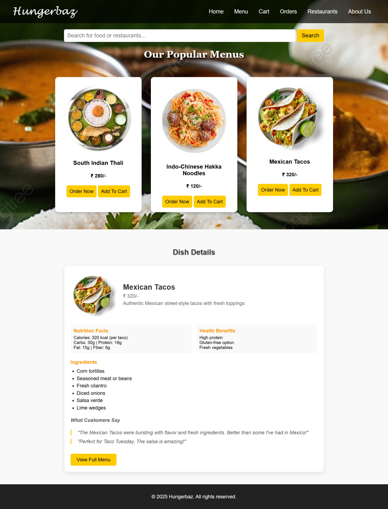
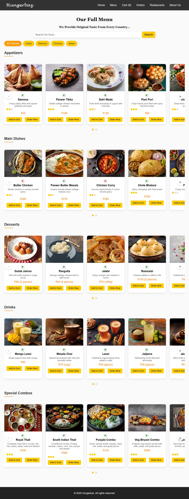
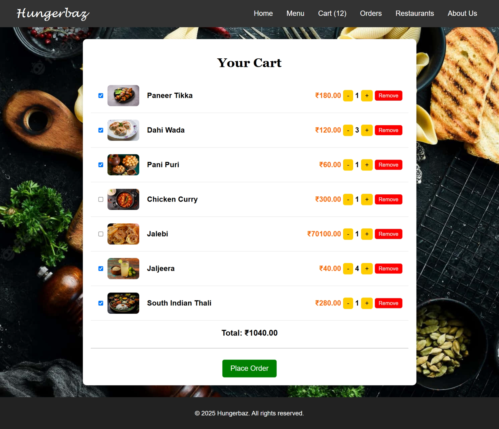

# Hungerbaz - Food Ordering Web Application

A fully responsive, user-friendly online food ordering web application designed to provide a seamless restaurant discovery and ordering experience. 

Live Demo: [View Live Website](https://arati-subhash-sutar.github.io/Hungerbaz/)

---

## Key Features
* User Authentication: Secure user signup, login, and profile management.
* Dynamic Menu Exploration: Browse a variety of food categories, dishes, and restaurant options.
* Interactive Cart & Ordering: Add items to cart, manage quantities, and proceed through a streamlined checkout flow.
* Order Tracking & Confirmations: Dedicated pages for order details and confirmation status.
* Feedback & Contact Support: Integrated feedback submission and customer inquiry forms.

---

## Tech Stack
* Frontend: HTML5, CSS3, JavaScript
* Backend Database: MySQL (XAMPP / phpMyAdmin)
* Version Control: Git & GitHub
* Hosting: GitHub Pages

---

## Database Schema (database.sql)
The application uses a structured relational database designed to handle users, orders, feedback, and customer queries efficiently:
* `users` - Manages customer account credentials and registration data.
* `orders` - Stores transaction details, order items, addresses, and timestamps.
* `feedback` - Captures user ratings and review messages.
* `contacts` - Logs customer inquiry submissions.

*(View the complete code structure in the repository's `database.sql` file).*

---

## System Architecture & Data Flow
1. **Frontend Interaction:** Users interact with HTML pages (`index.html`, `menu.html`) to browse items, add products to the cart, or fill out contact/feedback forms.
2. **Form Submission & Handling:** User input is processed and structured to match relational database requirements.
3. **Database Integration:** The backend schema (`database.sql`) captures and stores user credentials in the `users` table, logs orders in the `orders` table, and tracks customer inquiries via the `contacts` and `feedback` tables.

---

## Project Snapshots

### Homepage


### Menu


### Cart


---

## Getting Started Locally
To run this project on your local machine:
1. Clone this repository or download the ZIP folder.
2. Set up a local server environment using XAMPP and import the `database.sql` file into phpMyAdmin.
3. Open `index.html` in your preferred web browser or code editor (like Visual Studio Code).

---
Developed by Arati Subhash Sutar

```
